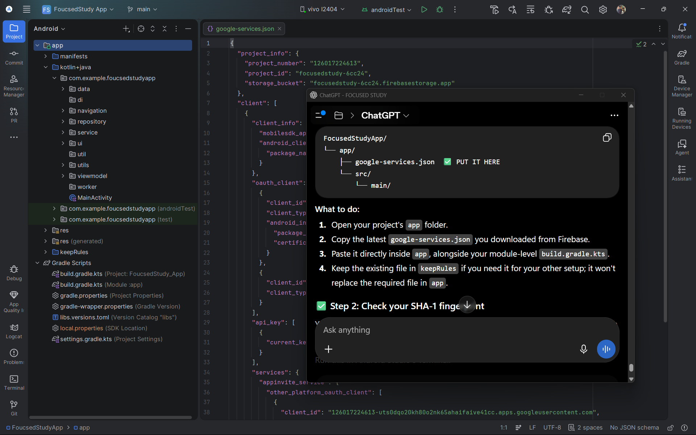

<div align="center">



# 📚 Focused Study

**A productivity app that helps students eliminate distractions and build consistent study habits.**

[](https://android.com)
[](https://kotlinlang.org)
[](https://developer.android.com/jetpack/compose)
[](https://firebase.google.com)
[](https://developer.android.com/about/versions/nougat)
[](LICENSE)

</div>

---

## ✨ Features

### 🔒 Smart App Blocking
Block distracting apps during study sessions using Android's Accessibility Service. When you try to open a blocked app, you're redirected back to the timer — keeping you on track.

### ⏱️ Focus Timer
- Custom session duration
- **Pause & Resume** support
- End-session confirmation dialog
- Animated color transitions between active / paused states

### 📊 Stats & Progress Tracking
- Daily study time and session count
- Streak tracking (consecutive study days)
- Session history log
- Visual progress cards

### 🏆 Leaderboard
- Weekly study-time leaderboard across all users
- Podium display for top 3 performers
- "YOU" badge to highlight your rank

### 🛡️ Internet Gate
- App requires an active internet connection to work
- Live connectivity monitoring — auto-resumes when connection is restored
- Prevents offline usage to maintain data integrity

### 🔍 App Selection
- Search through installed apps
- **Select All / Deselect All** toggle
- Live counter — *"X of Y apps will be blocked"*

### 🔐 Authentication
- Email & password sign-up / login
- Google Sign-In via Credential Manager API
- Password strength checklist on signup

---

## 🛠️ Tech Stack

| Layer | Technology |
|-------|-----------|
| **Language** | Kotlin 2.x |
| **UI** | Jetpack Compose + Material 3 |
| **Navigation** | Navigation Compose |
| **Architecture** | MVVM (ViewModel + Repository + Service) |
| **Backend** | Firebase Auth + Cloud Firestore |
| **Local Storage** | Room Database + SharedPreferences |
| **Background Work** | WorkManager + Accessibility Service |
| **Auth** | Firebase Auth + Google Identity (Credential Manager) |
| **Async** | Kotlin Coroutines + Flow |
| **Build** | Gradle (KTS) + KSP |

---

## 🏗️ Architecture

```
app/
├── data/                    # Data models (User, FocusSession)
├── navigation/              # NavHost, Screen routes, BottomNavBar
├── repository/              # Data access layer (Auth, Focus, Home, Leaderboard)
├── service/
│   ├── AppBlockingService   # Accessibility Service — intercepts blocked apps
│   ├── AuthService          # Firebase Auth operations
│   ├── HomeService          # Firestore stats + streak updates
│   └── LeaderboardService   # Weekly leaderboard queries
├── ui/
│   ├── screens/             # Composable screens
│   │   ├── WelcomeScreen
│   │   ├── login/           # LoginScreen, SignupScreen
│   │   ├── home/            # HomeScreen
│   │   ├── focus/           # FocusScreen, TimerScreen
│   │   ├── leaderboard/     # LeaderboardScreen
│   │   ├── stats/           # StatsScreen
│   │   └── permissions/     # AccessibilityPermissionScreen
│   └── theme/               # Color, Typography, Theme (Material 3)
├── utils/
│   ├── FocusManager         # SharedPrefs-backed focus/pause state
│   ├── NetworkUtils         # Live connectivity check + NoInternetScreen
│   └── AccessibilityUtils   # Accessibility service helpers
└── viewmodel/               # HomeViewModel, FocusViewModel, LeaderBoardViewModel, etc.
```

---

## 📱 Screenshots

> Coming soon

---

## 🚀 Getting Started

### Prerequisites
- Android Studio **Hedgehog** or later
- Android device / emulator running **API 24+**
- A Firebase project with **Auth** and **Firestore** enabled

### Setup

1. **Clone the repository**
   ```bash
   git clone https://github.com/AbhinayJangala/Focused-Study.git
   cd Focused-Study
   ```

2. **Add your Firebase config**
   - Go to [Firebase Console](https://console.firebase.google.com) → your project → Project Settings
   - Download `google-services.json`
   - Place it at `app/google-services.json`

   > ⚠️ `google-services.json` is gitignored and must never be committed.

3. **Enable Firestore & Authentication**
   - Firebase Console → Authentication → Enable **Email/Password** and **Google**
   - Firebase Console → Firestore → Create database in production mode

4. **Run the app**
   ```bash
   ./gradlew assembleDebug
   ```
   Or press **Run ▶** in Android Studio.

5. **Grant permissions**
   - On first launch, grant **Accessibility Service** permission to enable app blocking
   - The app will guide you step-by-step

---

## 🔑 Permissions

| Permission | Purpose |
|-----------|---------|
| `INTERNET` | Firebase & network connectivity check |
| `ACCESS_NETWORK_STATE` | Live internet connectivity monitoring |
| `BIND_ACCESSIBILITY_SERVICE` | Detect & block distracting apps during sessions |
| `RECEIVE_BOOT_COMPLETED` | Restore session state after device reboot |
| `QUERY_ALL_PACKAGES` | List installed apps for the app selector |

---

## 🗄️ Firestore Data Model

```
users/
└── {uid}/
    ├── name              : String
    ├── email             : String
    ├── totalStudySeconds : Long
    ├── sessionsCompleted : Long
    ├── currentStreak     : Int
    ├── lastStudyDate     : Timestamp
    └── weeklyStudySeconds: Long
```

---

## 🤝 Contributing

Contributions are welcome! Please:

1. Fork the repository
2. Create a feature branch: `git checkout -b feature/your-feature`
3. Commit your changes: `git commit -m "feat: add your feature"`
4. Push and open a Pull Request

---

## 📄 License

```
MIT License

Copyright (c) 2024 Abhinay Jangala

Permission is hereby granted, free of charge, to any person obtaining a copy
of this software and associated documentation files (the "Software"), to deal
in the Software without restriction, including without limitation the rights
to use, copy, modify, merge, publish, distribute, sublicense, and/or sell
copies of the Software, and to permit persons to whom the Software is
furnished to do so, subject to the following conditions:

The above copyright notice and this permission notice shall be included in all
copies or substantial portions of the Software.

THE SOFTWARE IS PROVIDED "AS IS", WITHOUT WARRANTY OF ANY KIND, EXPRESS OR
IMPLIED, INCLUDING BUT NOT LIMITED TO THE WARRANTIES OF MERCHANTABILITY,
FITNESS FOR A PARTICULAR PURPOSE AND NONINFRINGEMENT.
```

---

<div align="center">

Made with ❤️ by [Abhinay Jangala](https://github.com/AbhinayJangala)

</div>
